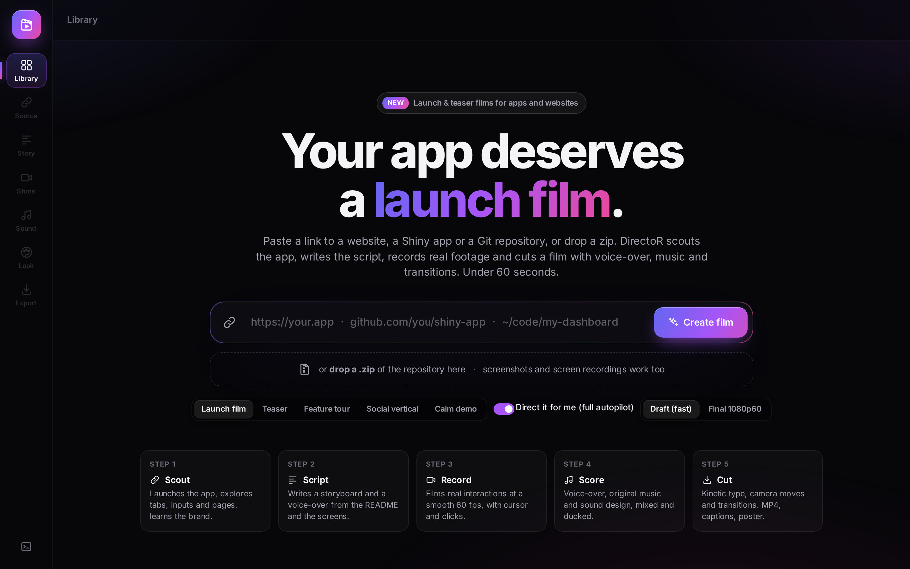
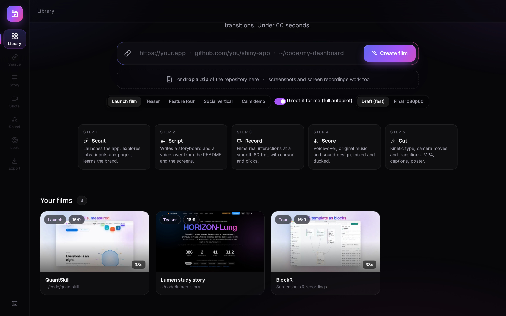
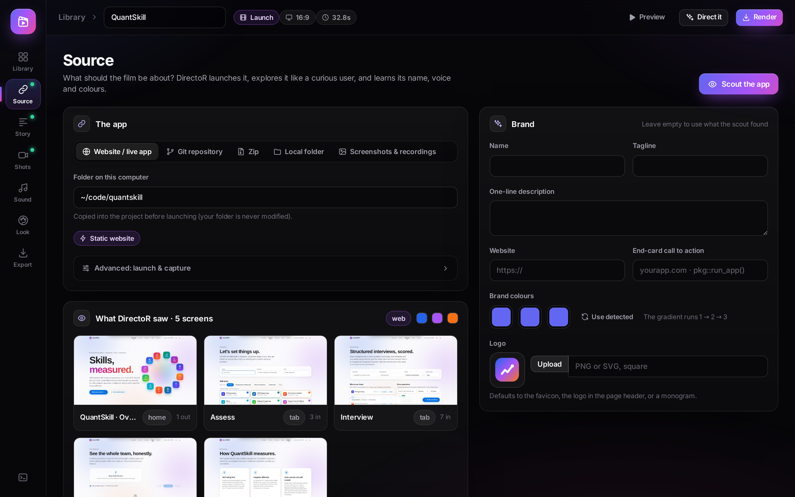
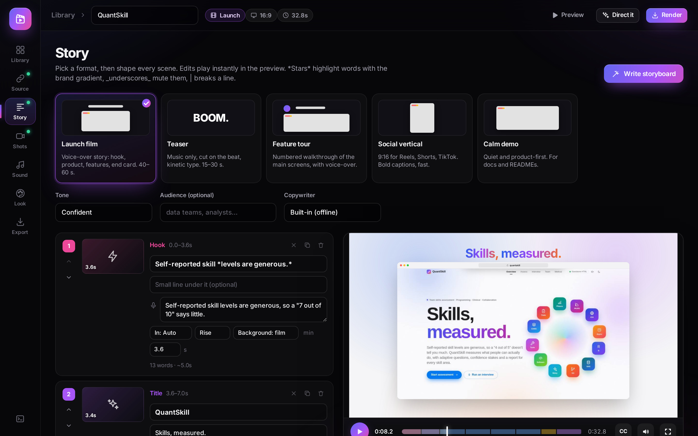
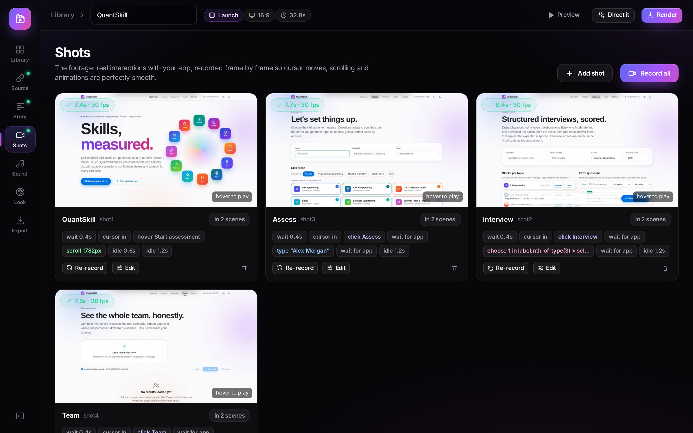
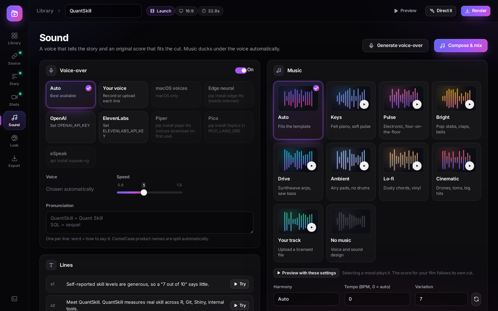
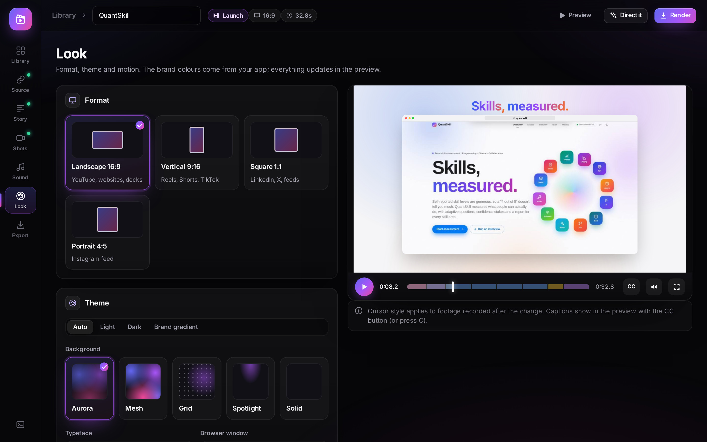
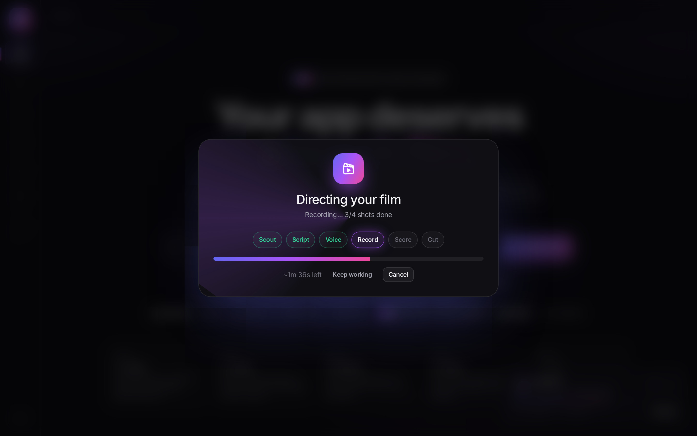
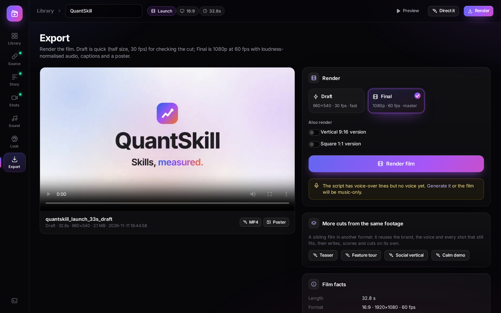
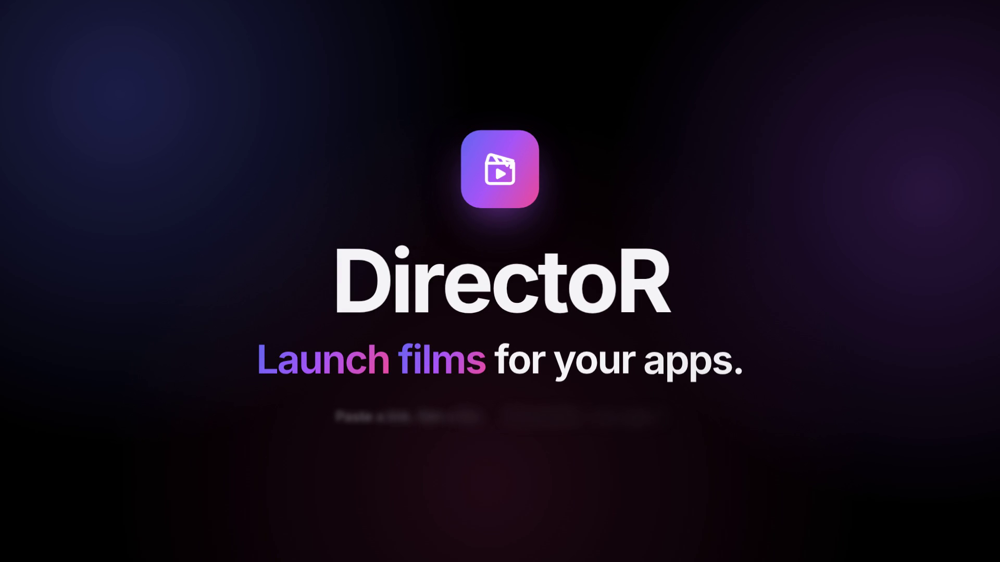

# DirectoR: design and delivery

DirectoR belongs to the **Lumen** framework (cinematic, high-contrast, glass-driven) of the Taiga design system. Its dialect: **Studio dark**.

- Framework styleguide: [`../../taiga-design-system/lumen/STYLEGUIDE.md`](../../taiga-design-system/lumen/STYLEGUIDE.md)
- Requirements for new projects: [`../../taiga-design-system/lumen/REQUIREMENTS.md`](../../taiga-design-system/lumen/REQUIREMENTS.md)
- Delivery model (Shiny · Quarto · HTML): [`../../taiga-design-system/DELIVERY_MODEL.md`](../../taiga-design-system/DELIVERY_MODEL.md)
- Extracted tokens: [`../../taiga-design-system/tokens/DirectoR.json`](../../taiga-design-system/tokens/DirectoR.json), contrast: [`../../taiga-design-system/tokens/contrast.md`](../../taiga-design-system/tokens/contrast.md)

## Look

Dark only (`#07070a`, text `#f4f4f6`), Inter (shipped), white-at-low-alpha panels (`.032 / .055 / .085`), the brand gradient `linear-gradient(120deg, #6366f1, #a855f7 48%, #ec4899)` on the logo, primary actions and key words, a glass rail (84 px) with a glowing active indicator, choice cards with live visual previews, drifting radial glows.

| | |
|---|---|
| Where the look lives | `inst/app/www/director.{css,js}`, `R/ui.R`, `R/components.R`; film look: `inst/engine/stage/` |
| Token scope | `:root (--bg, --panel, --a1…--a4, --grad)` |
| Custom properties | 26 |
| `backdrop-filter` / gradients / keyframes | 8 / 28 / 21 |
| Font stacks | `var(--font)`, `"SF Mono", "JetBrains Mono", Menlo, Consolas, monospace` |
| Component namespaces (most used) | `dr`, `scene`, `vis`, `irs`, `tr`, `cards`, `film`, `form` |

## Feature screenshots

Captured from a **test bench**, not the full running app (no R runtime was available where these were made). The page is built from the app's own unmodified R UI code (run in webR, R compiled to WebAssembly) and its own stylesheets, scripts and fonts. Server results come from the app's own functions where they can run in base R; the rest are stand-ins, listed in `taiga-design-system/VERIFICATION.md`. This is the same kind of bench the project's own `preview/` images were made on.

Files: `docs/features/*.jpg` (2880 × 1800), with titles, captions and provenance in `docs/features/manifest.json`. Regenerate: `python3 taiga-design-system/tools/screens/director.py`.

| | |
|---|---|
|  **Library**: Paste a link, a Git repository or a zip; pick a template and let autopilot direct the film. |  **Your films**: Each film is a project folder; the cards show what the scout saw. |
|  **Source & scout**: The scout launched the app, explored its tabs and learned its name, colours and screens. |  **Story**: Storyboard written from the README and the screens, with the live preview playing the real footage. |
|  **Shots**: Footage recorded frame by frame with a virtual clock: each shot is an editable recipe of actions. |  **Sound**: Voice providers (with what to install), seven music moods, and the voice-over lines. |
|  **Look**: Format, theme, background and motion; every change updates the preview. |  **Autopilot**: Direct it for me: scout, script, voice, record, score and cut, with live progress. |
|  **Export**: Draft or Final 1080p60, extra aspect ratios, and sibling cuts from the same footage. |  |

## Delivery formats: Shiny · Quarto · HTML

Every Taiga project specifies the triple-format delivery model (one front end, three hosts). Status for DirectoR:

| Format | Status | Entry point | What it gives |
|---|---|---|---|
| Shiny | ✓ shipped | `run_app()`, `director_app()`, `app.R` | The studio: scout, script, record, score, cut. |
| Quarto | **specified, not yet built** | planned `dr_export_quarto(project)` | A press-kit document: film, script with timings, storyboard, stills. |
| HTML | **specified, not yet built** | planned `dr_export_html(project)` | One file per film: video, captions (WebVTT), poster, script; or the engine's live preview inlined. |

The Quarto and HTML formats are specified in the delivery model, with a plan that reuses what the app already has: [`DELIVERY_MODEL.md` §5.1](../../taiga-design-system/DELIVERY_MODEL.md#51-plans-for-the-gaps). Requirements: DLV-01 to DLV-32.

Capability matrix:

| Capability | Shiny | Quarto | HTML |
|---|---|---|---|
| Runs without a server | – | ✓ | ✓ |
| Server-side computation / secrets | ✓ | – | – |
| Persistence across sessions and devices | ✓ | browser only | browser only |
| Author commentary around the tool | – | ✓ | – |
| Works offline / e-mailable | – | with `embed-resources` | ✓ |

## Promotional video

`media/DirectoR_teaser_30s.mp4`: 30 s, 1920 × 1080, 60 fps, H.264 + AAC, −14 LUFS, music only. It was made with **QuantSkill's video utility** (`QuantSkill/dev/video`: deterministic recorder, stage engine, synthesised score), driven by `taiga-design-system/tools/video/directoR/`. See [`../media/README.md`](../media/README.md).

